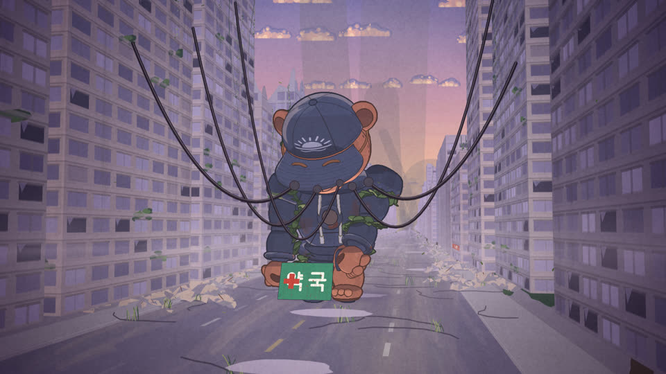
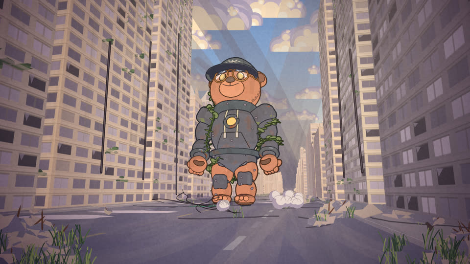
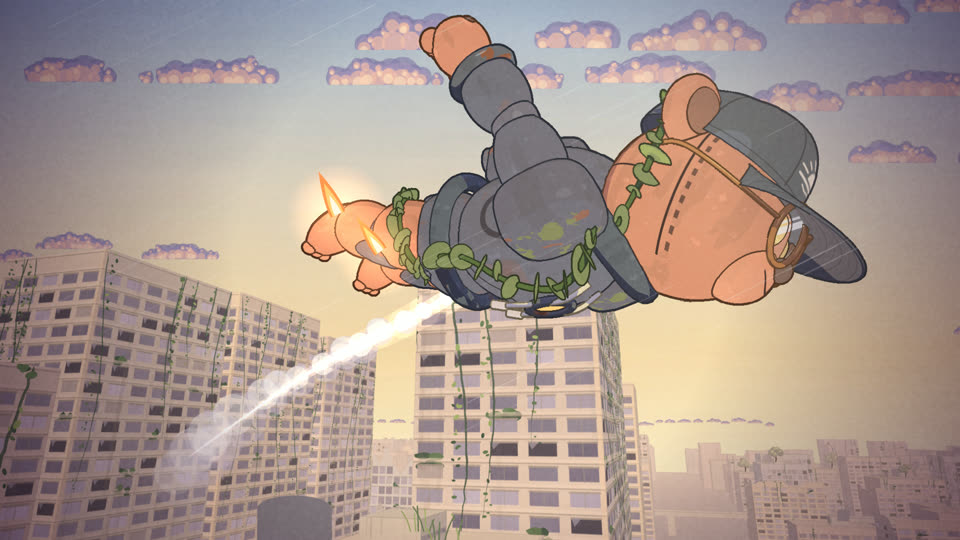
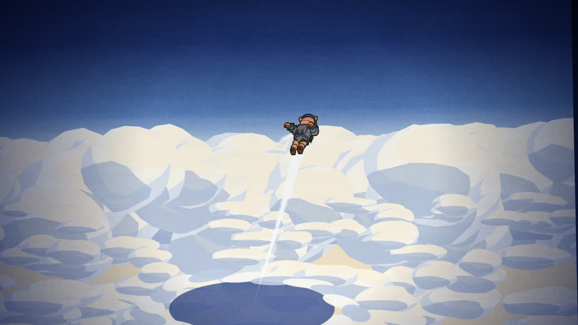
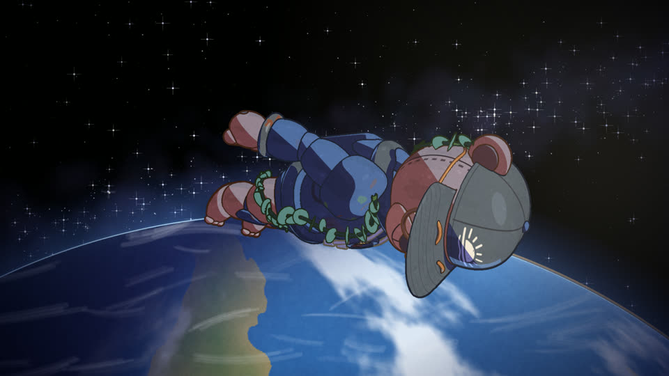

# 새벽곰 — DAWN BEAR

폐허가 된 도시에서 오래 무릎 꿇고 있던 거대한 곰 로봇이 새벽 첫 햇살에 깨어나 우주까지 날아오르는 **91초 2D 애니메이션**입니다.
이미지·영상·오디오 파일은 하나도 쓰지 않았습니다. 그림과 소리는 모두 코드로 그리고 합성하며, 결과물은 **HTML 파일 하나**입니다.

**▶ 라이브 데모: https://jeiel85.github.io/dawn-bear/**

> 첫 실행 때 배경을 그리고 사운드트랙을 합성하느라 20~40초쯤 걸립니다(진행 막대가 보입니다). 준비되면 화면을 클릭하세요.
> 데스크톱 Chrome·Edge에서 확인했습니다. WebGL2와 Web Audio가 필요합니다.

| | |
|---|---|
|  |  |
|  |  |
|  |  |

## 조작

| 입력 | 동작 |
|---|---|
| 클릭 / `Space` | 처음부터 재생 · 일시정지 · 다시 재생 |
| `←` `→` | 5초 뒤로 / 앞으로 |
| `M` | 소리 끄기 / 켜기 |
| `R` / `Home` | 처음부터 |
| `F` | 전체 화면 |

## 무엇이 들어 있나

- **단일 파일**: `index.html` 하나에 모든 코드와 타이틀용 글꼴 3글자(서브셋, data URI)가 들어 있습니다. 외부 라이브러리, 외부 글꼴, 네트워크 요청이 없습니다.
- **결정론적**: 난수는 모두 시드 기반입니다. 같은 프레임 번호는 언제나 같은 그림, 같은 소리를 냅니다.
- **1920×1080, 24fps, 91초**: 화면 시계는 오디오 시계를 따릅니다. 탐색·일시정지·재시작을 해도 그림과 소리가 어긋나지 않습니다.

### 그림
- **구아슈 배경**: 로딩 중에 Canvas 2D로 붓 엔진을 돌려 배경을 그립니다. 마른 붓 결, 종이 질감, 손떨림 있는 가장자리, 안료가 고이는 테두리까지 표현합니다. 건물은 3D 배치를 카메라로 투영한 뒤 그 면을 붓으로 칠하므로, 로봇과 원근이 정확히 맞습니다.
- **셀 셰이딩 로봇**: WebGL2로 그립니다.
  - 하드 셀 그림자와 그림자 맵 기반 자기 그림자
  - 깊이·법선·재질 경계에서 뽑은 잉크 선(굵기와 필압이 변하고, 2프레임마다 미세하게 떨림)
  - 녹·칠 벗겨짐·이끼 같은 풍화 표현
- **원화 타이밍**: 로봇 동작은 대부분 2프레임(2s), 미끄러지는 순간은 1프레임(1s)으로 끊어 그립니다. 비행할 때 몸 방향은 속도보다 0.3초 늦게 따라가고, 회전할 때 기울며, 난기류에 1~2프레임씩 흔들립니다.
- **2D 이펙트**: 참새, 새 떼, 셀 먼지구름, 잔해, 케이블, 균열, 추진 화염, 바람 고리, 빛줄기, 비행운을 그립니다. 모두 시간에 대한 순수 함수라 어느 시점으로 탐색해도 같은 그림이 나옵니다.
- **마감**: 컷마다 색보정을 하고, 투과광, 필름 그레인(2프레임마다 바뀜), 비네트를 얹습니다.

### 소리
- 시작할 때 `OfflineAudioContext`로 사운드트랙 전체를 한 번 렌더링합니다. 그래프를 1초 단위로 필요한 음표만 만들고 끝난 노드는 떼어 내기 때문에, 그림 그리기와 동시에 약 14초 만에 끝납니다.
- 앰비언스: 새벽바람과 돌풍, 먼 새소리, 물방울, 케이블 삐걱임.
- 효과음은 화면 사건에 맞춰 정확한 시각에 예약합니다.
  - 참새 착지(16.0초), 가슴 창 점멸(27.1, 27.4, 27.8초)
  - 땅울림과 새 떼 날갯짓(31.3초), 간판 추락(39.7초)
  - 점화(53.55초), 바람 고리(54.3초)
  - 도플러 패스바이(61.25초), 구름 관통(68.5초)
- 음악: 독창적인 선율의 테마입니다. 피아노 솔로로 시작해 현악 트레몰로, 일어설 때의 화음, 서스펜디드 화음과 침묵, 팀파니로 이어집니다. 비행에서는 현·호른·피아노가 전체 테마를 연주하고, 우주에서는 피아노·첼레스타로 리프라이즈한 뒤 종소리로 끝납니다.
- 마스터링: 서브소닉 하이패스와 4배 오버샘플링 트루피크 리미터를 거칩니다. 91.0초에는 완전한 무음입니다.

## 검증 결과

`tools/`의 스크립트로 헤드리스 Chrome(실제 GPU)에서 측정했습니다.

| 항목 | 목표 | 결과 |
|---|---|---|
| 통합 음량 | 약 −16 LUFS | **−15.8 LUFS** |
| 트루피크 | ≤ −1 dBTP | **−1.3 dBTP**, 클리핑 없음 |
| 오프닝(3–20초) 단기 음량 | −28 ~ −24 LUFS | **−28.0 ~ −24.9** |
| 가장 큰 순간 | 패스바이, 최대 약 −9 LUFS | **61.5초, −10.0 LUFS** |
| 효과음 타이밍 | ±50 ms | 예약 시각은 화면 사건과 같습니다. 파형에서 검출되는 타격음(균열·간판·미끄러짐·착지·점화·바람 고리·종소리 등)은 **−5 ~ +10 ms** |
| 머리 잘림 | 머리가 온전해야 하는 컷에서 0 | **0프레임**(모든 프레임 검사) |
| 콘솔 오류 / 네트워크 요청 | 0 / 0 | **0 / 0** |
| 재생 성능 | 24fps | 프레임당 CPU 약 2~3 ms(RTX 5060 노트북 기준) |

## 구조

```
index.html          ← 배포용 단일 파일(빌드 결과물, GitHub Pages가 이 파일을 서비스)
src/
  shell.html        HTML 골격, 로딩 화면, 글꼴 라이선스 주석 자리
  core.js           시드 난수, 노이즈, 행렬, 색
  brush.js          구아슈 붓 엔진(종이, 마른 붓, 흔들리는 선)
  paint_bg.js       하늘·구름·건물 외벽·덩굴·나무·안개·간판·별 화가
  world.js          폐허 도시 배치, 원근 투영으로 칠하는 건물·거리·고가도로
  camera.js         배경 레이어와 GPU 로봇이 함께 쓰는 카메라
  robot_geo.js      새벽곰 메시·뼈대·IK
  robot_gl.js       WebGL2 셀 셰이딩, 그림자 맵, 잉크 선 패스
  anim.js           키 포즈, 일어서기 타이밍, 비행 자세
  fx.js             참새·새 떼·먼지·화염·비행운 등 2D 이펙트와 마감
  shots.js          컷 목록(카메라·레이어·연출)
  audio.js          사운드트랙 합성과 마스터링
  title.js          엔딩 타이틀(구아슈로 칠한 '새벽곰')
  main.js           로딩, 오디오 시계 재생, 조작, 디버그 훅
tools/              빌드·검증 스크립트(Node 22+, Chrome, ffmpeg)
```

## 개발

```bash
node tools/build.mjs                     # src/ → index.html
node tools/frames.mjs out 12.5 44 61.4   # 지정 시각의 프레임을 PNG로
node tools/sheet.mjs out 4 480           # 컨택트 시트
node tools/audio.mjs soundtrack.wav      # 사운드트랙 WAV + 음량·피크·타이밍 리포트
node tools/check_framing.mjs             # 모든 프레임에서 머리 잘림 검사
node tools/headsheet.mjs heads.png       # 컷별 머리 클로즈업(캡·안경 일관성)
node tools/smoke.mjs                     # 실제 재생·조작·콘솔·네트워크 점검
node tools/perf.mjs                      # 컷별 프레임 비용(rAF 기준)
node tools/loadprof.mjs                  # 로딩 단계별 그리기 시간
```

타이틀 글꼴 서브셋은 `python tools/subset_font.py <MaruBuri-Bold.woff2> src/title_font.b64`로 다시 만들 수 있습니다(fontTools와 brotli 필요). 원본 글꼴 파일은 저장소에 포함하지 않습니다.

## 크레딧

- 아이디어: Threads [@ai_sync_club](https://www.threads.com/@ai_sync_club) 게시물에 공개된 프롬프트에서 영감을 받았습니다. 구현 코드와 작품 제목, 캡 엠블럼, 타이틀은 이 저장소에서 새로 만들었습니다.
- 타이틀 글꼴: 네이버 **마루부리 Bold**의 3글자 서브셋입니다. OFL 규정에 따라 글꼴 내부 이름을 `DawnTitleSerif`로 바꿨습니다. Copyright © NAVER Corp. © NAVER Cultural Foundation Corp., Reserved Font Name "MaruBuri", [SIL Open Font License 1.1](https://openfontlicense.org). 저작권 표기와 라이선스 전문은 `index.html` 안 주석에 들어 있습니다.

## 라이선스

코드는 [MIT](LICENSE)입니다. 임베드한 글꼴 서브셋은 SIL OFL 1.1을 따릅니다.
